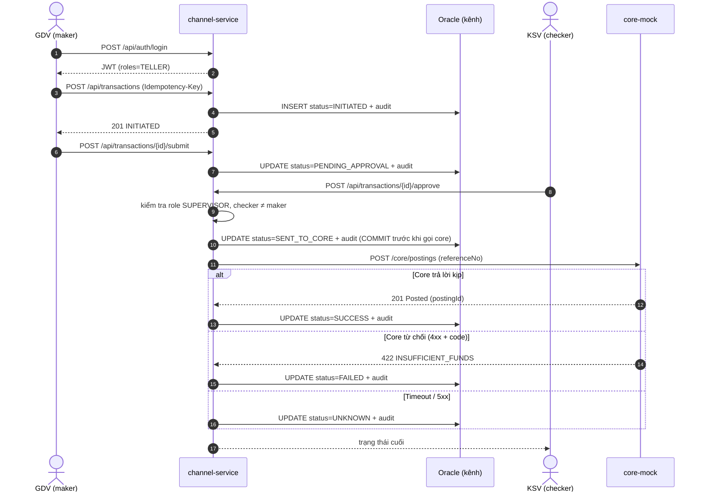
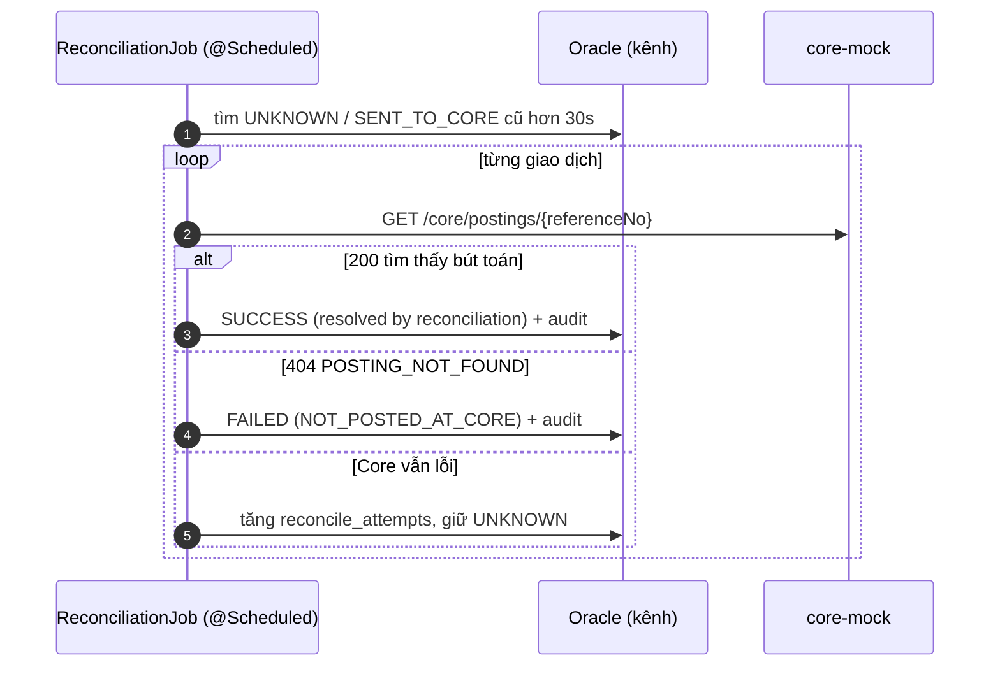
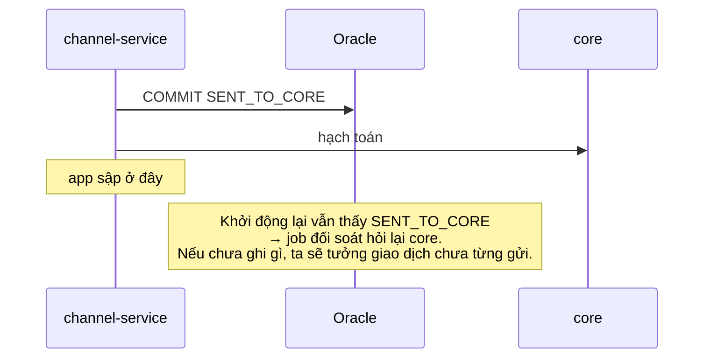
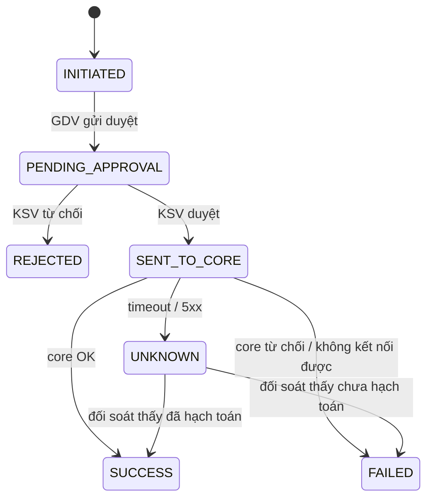

# Sequence diagram

GitHub hiển thị trực tiếp các sơ đồ Mermaid bên dưới.

## 1. Luồng chính: rút tiền có maker-checker

## 2. Đối soát giao dịch CHƯA RÕ

## 3. Vì sao ghi `SENT_TO_CORE` trước khi gọi core

## 4. Vòng đời trạng thái

| Code | Tiếng Việt |
|---|---|
| `INITIATED` | KHỞI TẠO |
| `PENDING_APPROVAL` | CHỜ DUYỆT |
| `REJECTED` | TỪ CHỐI |
| `SENT_TO_CORE` | ĐÃ GỬI CORE |
| `SUCCESS` | THÀNH CÔNG |
| `FAILED` | THẤT BẠI |
| `UNKNOWN` | CHƯA RÕ |
